# greece 2021

ИТАК я был знаете где? да. в 2021 греции. 

(тут вышло много всего как то но вы держитесь)

# шо я там делал

всегда мечтал и вот поехал на культурный обмен, внутренний проект BESTa. (кроме нас было еще 8 студентов из Австрии, ну и ~20 людей из греции. 

# а где был

## ираклион

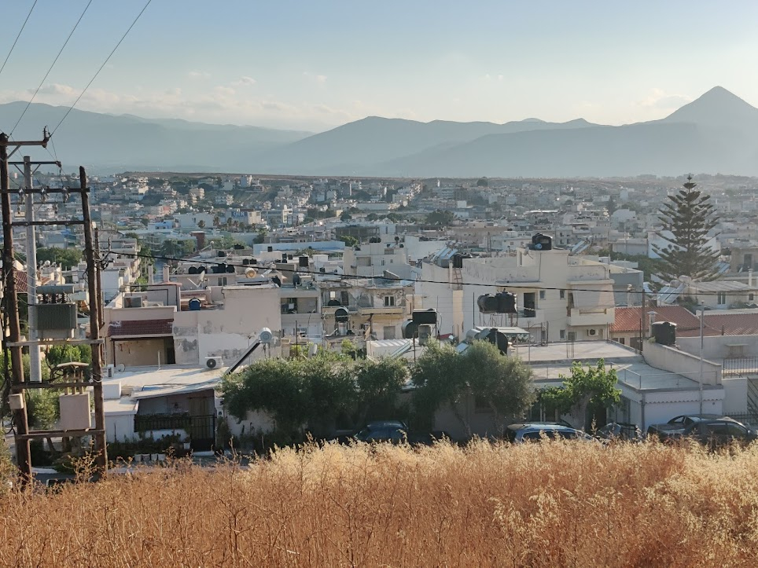

СНАЧала мы со мной (с украинцами) были 4 дня в Ираклеоне, на Крите. маленький город который проходится пешком за час с чем то И ОГРОМНЫМ МАГАЗИНОМ ДЛЯ ДЕТЕЙ СЕРЬЕЗНО Я ТАКОГО НЕ ВИДЕЛ ОТКУДА ПОЧЕМУ. 

подробнее?::::

мне сказали что туристически пригодным этот город стал ~2 годика назад. но он таки неплох. нам [очень повезло но все же] удалось снять ОХУЕННУЮ хату на 4 дня 20є с человека............

достопримечательностей там не очень много (или же мы просто не видели), есть полузамок возле порта, мы туда пришли ночью и он казался creepy.

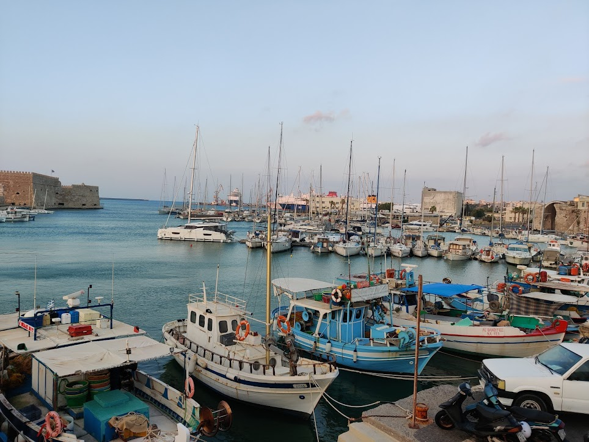

*тот замок слева*

### *улицы*

приятные, иногда нет пешеходных дорог но это ок так как машин не много. попадались суперузкие улочки, которые в сочетании с экзотическими маленькими скругленными машинами и уютными домами напомнили мне районы японии из фотографий.

когда ходили вечерами, видели как местные семьи лампово ужинают и общаются.

### *дома*

здесь разные однако очень похожие приемущественно белым цветом, острыми аккуратными углами и навесами на балконах. не смотря на улгы выглядят мягко приятно.

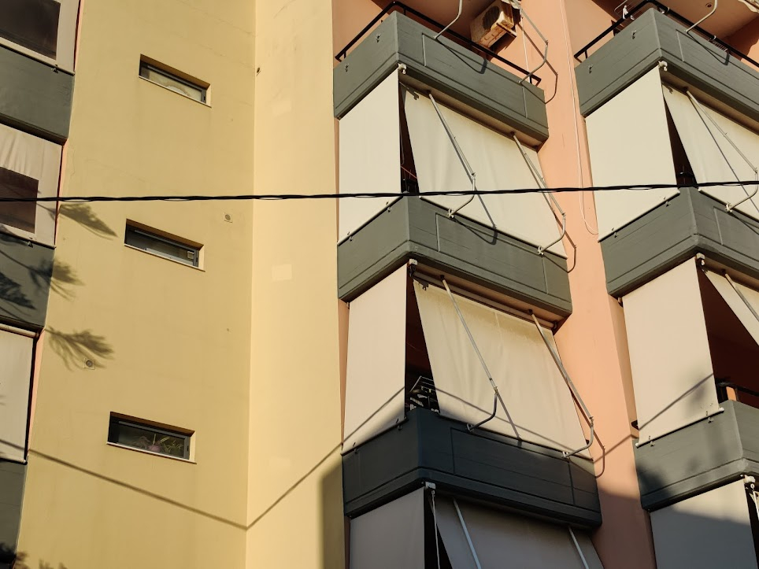

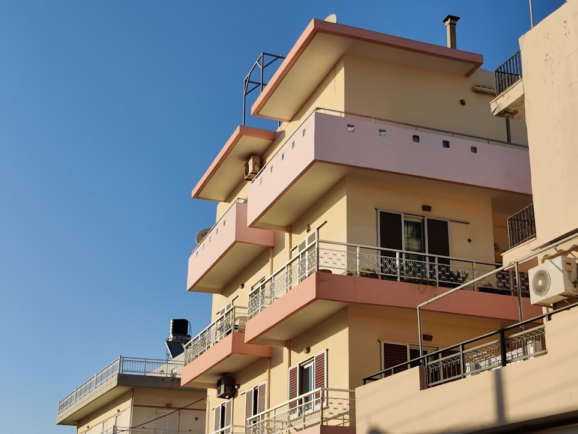

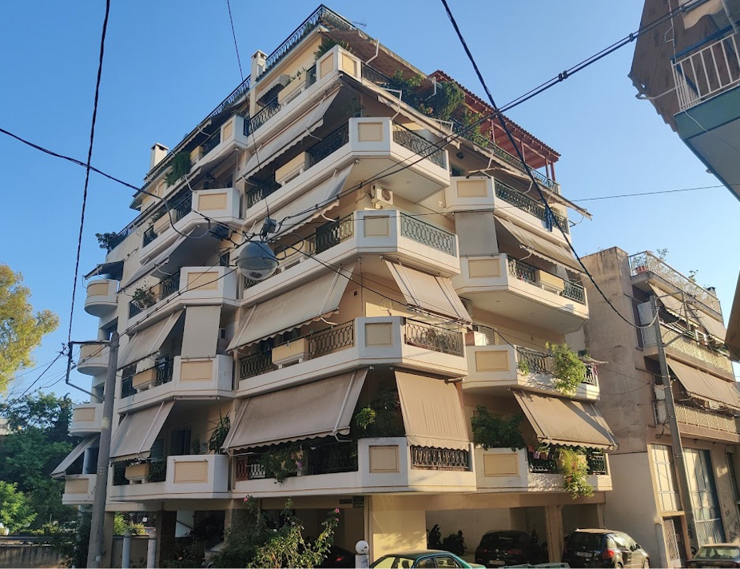

### *пет метни question mark*

познакомился?встретил уличного музыканта себастьяна который играл на гитаре, напомнил мне пета метни, к сожалению у него нет записей(( но если появятся скину

## паром

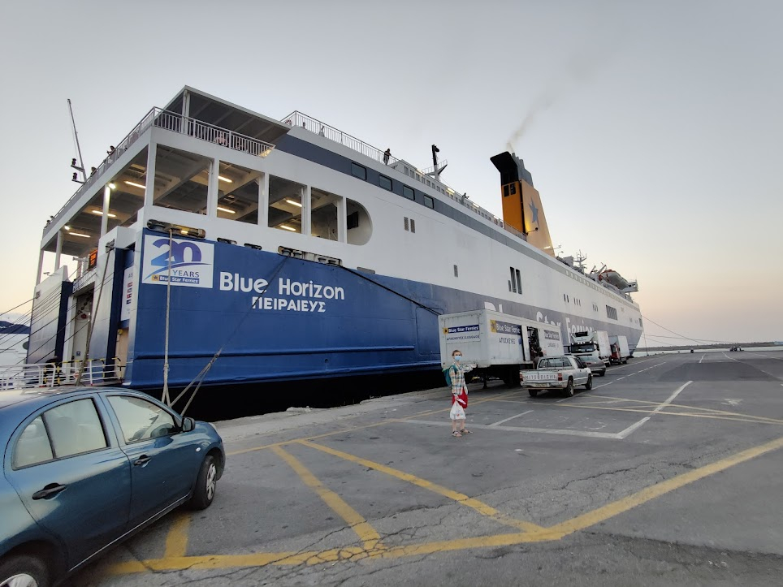

А ПОТооООМ мы поплыли на пароме в афины. на пароме было клево, но я ощутил универсальный прикол паромов - ТАМ БЛЯТЬ ОЧЕНЬ ХОЛОДНО 🥶. И ХОЛОД ДЕЛАЮТ ЛЮДИ БЛЯТЬ КОНДИЦИОНЕРАМИ ВНУТРИ ПАРОМА. я не понимаю почему зачем в чем прикол. чтобы не спали? чтобы покупали больше кофе по 4 евро или че?77............

*TODO: когда будете на пароме, попробуйте выйти на нос на палубе. только оставьте все вещи где то потому что 💨🌬;aljdfk;lg*

рассвет на пароме встречать было клево. сидим на креслах, слушаем какой то старый джаз на колонке и представляем (или скорее представляю, я бы доплатил много за живих джазовых паромных музыкантов) что его исполняют паромные музыканты из старой америки

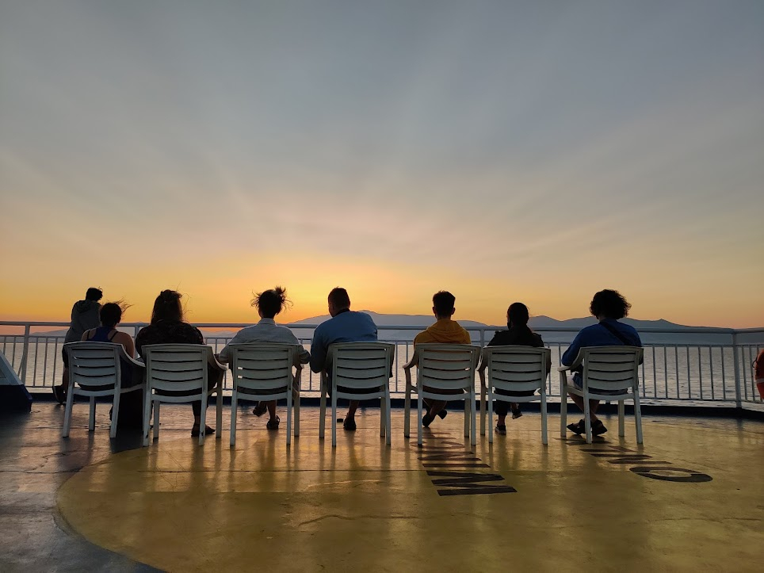

## афины

*мы пришли сегодня в порт* 

из палубы открывался вид на город, широкие (как оказалось потом) улицы казались узенькими, солнце только поднялось над горизонтом и давало золотое освещение

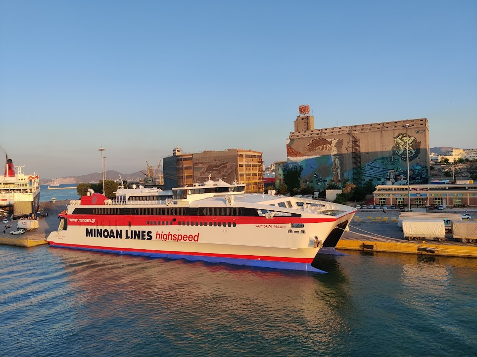

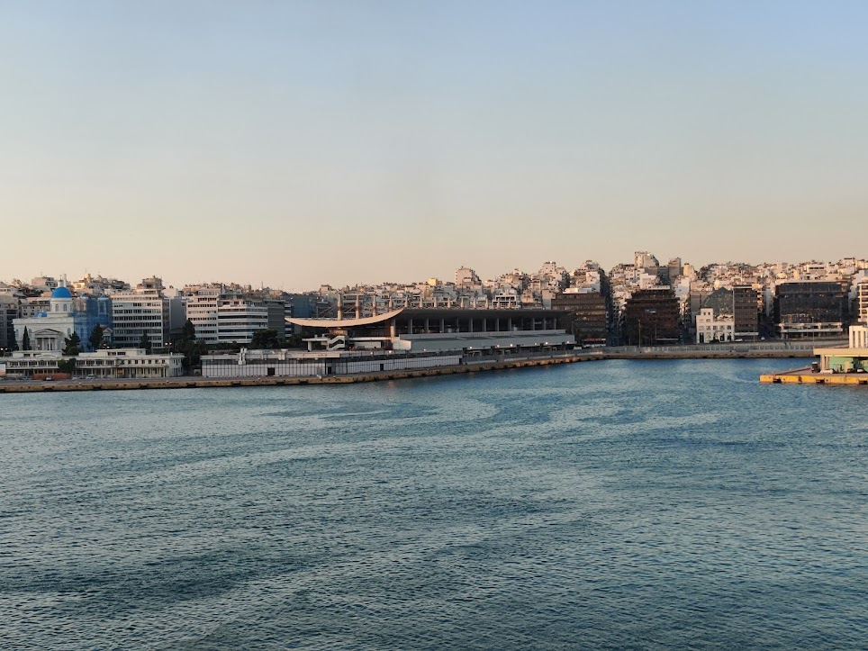

### *афины большие*

они разбиты на районы или что, так что гугл говорит что они в 3 раза меньше львова но по факту они больше киева. в греции живет 11млн людей и 6млн из них в афинах. так шо да. и высокоэтажек у них особо нету. так шо да.

### *транспортация*

в афинах хороший транспорт с одним билетом ко всем видам сразу. если вы без денег или авантюрист можете проходить в метро за другими людьми не имея билета, турникеты поблажливые и контролеров практически нет. в автобусе тоже никто не следит особо (однако говорят что контролеры существуют ¯\*(ツ)*/¯ )

(((повезло нам иметь пацана с симкартой с интернетом, без него мы бы потратили много лишних сил и времени. (в маленьком ираклеоне с трудом нашли дом по жаре уф). )))

### *метро*

здесь 4 ветки метро.

из за ковида, все окна обычно открыты

а из открытых окон звучат звуки апокалипсиса

чтобы уйти на 4 остановки дальше от конечной - в аеропорт например, прийдется заплатить 4.5є (или побыть авантюристом)

пару приколов:

- рекламы в метро почти нет
- станция с артхаусными инсталляциями

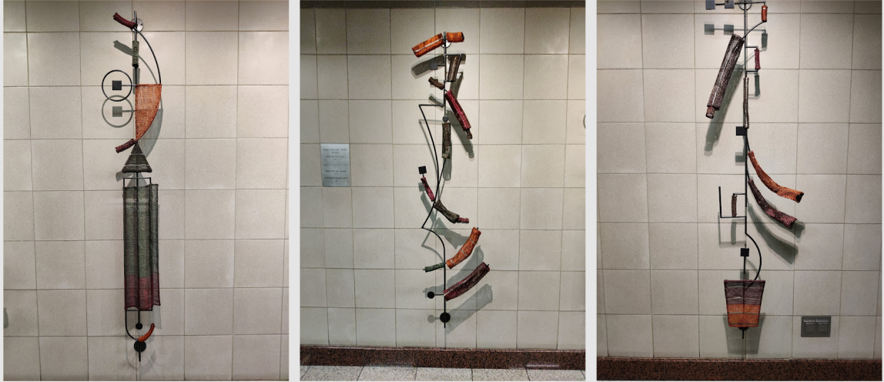

- станция с прозрачными стенами и археологическими находками из раскопок этой станции
- станция с бесплатными ковид тестами
- один поезд проспонсонсирован ковровой компанией с очень мягкими ковриками.
- в новых вагонах карта над дверьми показывает лампочками где мы и куда едем

*коммунистическая (и анархическая) символика*

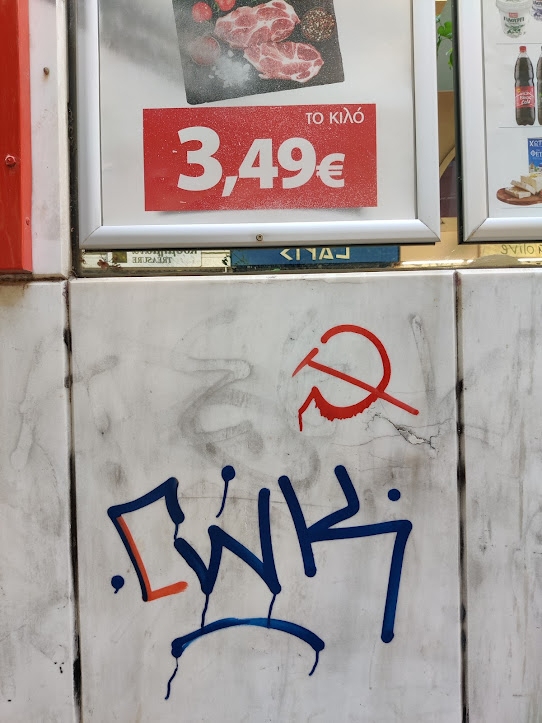

в ираклеоне мы замечали символы анархизма по стенам (ДАЖЕ НА ДЕТСКОМ САДИКЕ), думали что за прикол

а когда мы пришли к общежитиям мы охуели, стены были покрыты коммунистической символикой и призывами. нам обьяснили что это студенты активисты из политкружков которые пиздятся между собой?)0 ы. и что процент коммунистической партии вроде всего 4% так что все ок однако

### *однако социализм?*

ощущение что в греции немного присутствует социализм. все студенты получают бесплатное образование, они могут жить бесплатно, их кормит универ (достаточно неплохо как на бесплатно, мы как раз ихнюю еду и кушали потом). медицина тоже бесплатная, транспорт относительно дешевый, быстрые ковид тесты делаются возле станции метро и полностью бесплатные (но документальное подтверждение не выдают)

ну короче хм 

### *жилье*

жили мы в общежитиях университета греков. они были хорошие, с внутристенным кондиционером (который в большинстве комнат работал!1), в каждой комнате на двоих был душ, балкончик с жалюзями.

*организаторы были cautious на счет ковидности*

у них 30% вакцинированы, охуели когда узнали что в украине ~5%

cautious они были не только потому что много людей, большая ответственность но и потому что все они путешествуют куда то.

### *музыкант в общаге*

мне повезло услышать народную музыку от музыканта который жил возле нас в общаге! играл он на бузуки, играл суперкруто, какие то свадебные штуки вроде. иногда он смотрел на то как мы тусили :^)

### *SNFCC (Stavros Niarchos Foundation Cultural Center)*

ставрос ниарчос это грек биллионер который профинансировал много клевых штук, в том числе и этот культурный центр. внутри есть библиотека высотой в 5 этажей

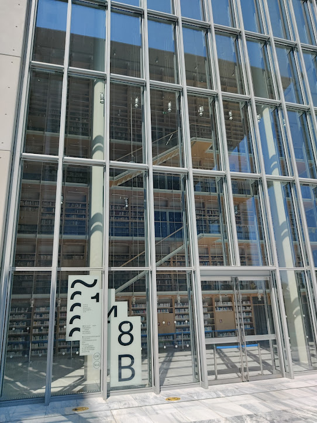

с крыши открывается вид на афины. красиво прикольно

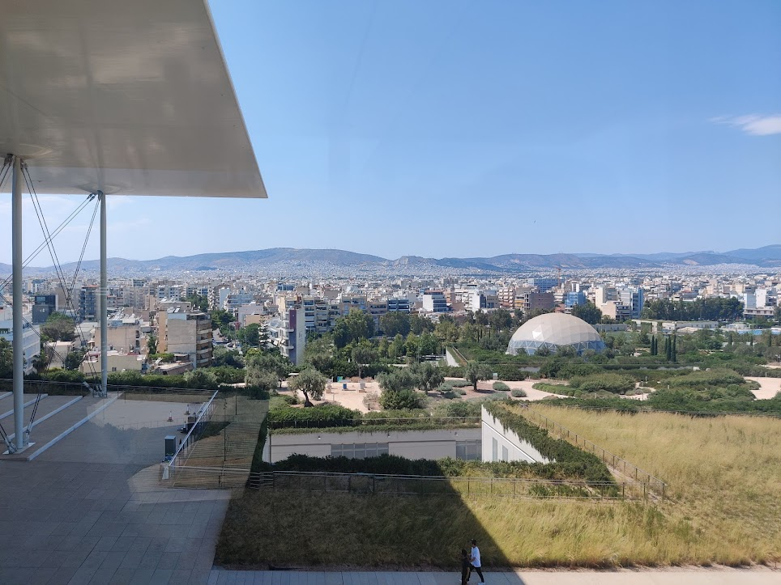

возле снфкц был пожилой музыкант с лирой и очень чисто играл приколы. мне понравилось

### *акрополис*

на сам акрополис мы не успели, однако были в музее напротив него. ТАМ ЕСТЬ МАЛЕНЬКИЕ ФИгурки собачек лошадок созданий.

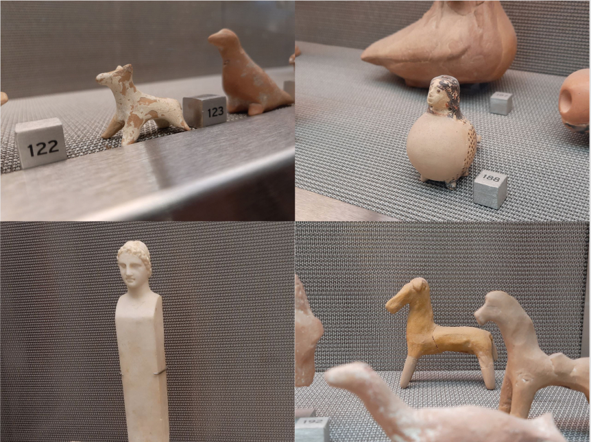

очень чисто хорошо комфортно

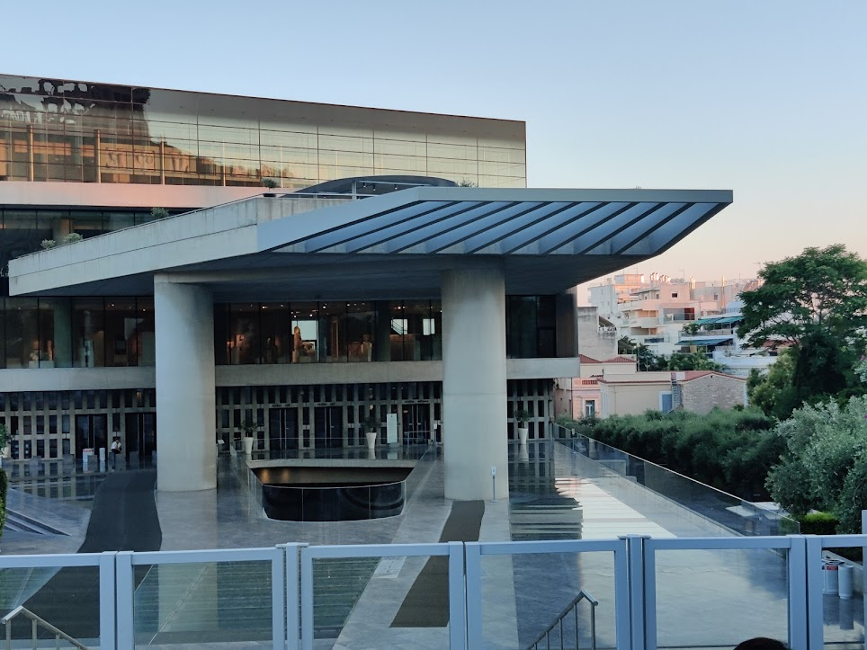

### *море*

пляжи в ираклеоне почему то круче. там побережье прикольнее и вода без фигни.

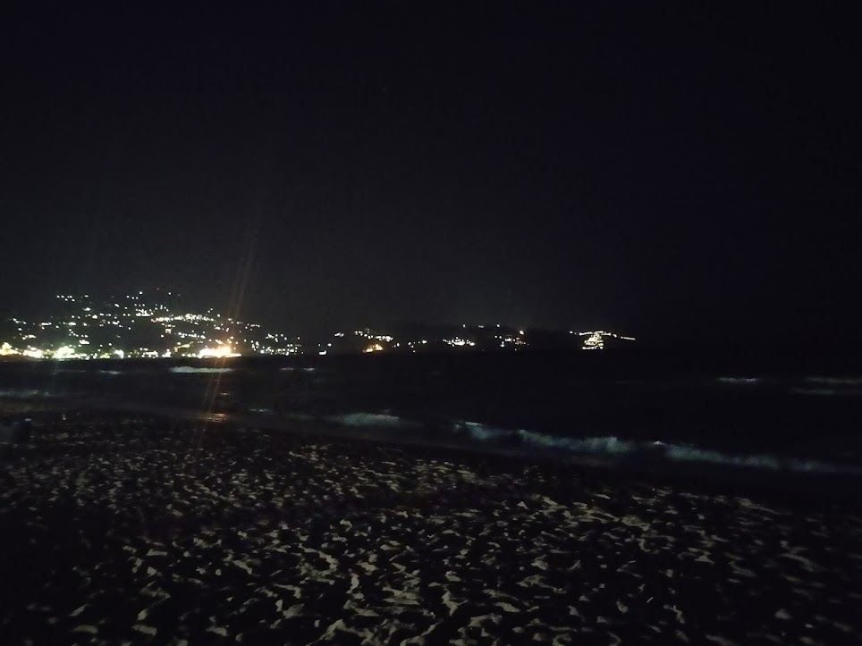

*когда ночью купались, было видно горы которые были похожи на мегаполис из за фонарей. красиво.* 

мы спали на пляже два раза.

в афинах тоже прекрасная прозрачная вода ( и иза за преломления и чистоты, два метра глубины кажутся половиной метра если со штуки с которой прыгали смотреть) но были морские колючки

вода пиздец соленая, до такой степени что когда высох после воды, под бровями образуются кристалики соли.

### *улици с сувенирами*

много. улиц. чисто с сувенирными магазинами. кстати я не нашел особо клевых вещей. когда идешь по таким улицам по ногам иногда проходит холодный ветер от помещений с кондиционерами, приятно

### *водители бешоные*

что в афинах, что в ираклионе, не останавливаются на переходе до последнего)000

тут очень много машин так что светофоры работают секунд 10-15 для пешеходов и 1+ минуту для машин мех.

### *ребята хорошие*

студенты как я понял клевые толерантные етц. но старшее поколение такое же консервативное как и у нас. в греции регулярно происходят какие то пиздецы типа харасментов, возможно больше чем в украине если мне про это три человека рассказывало.

однако в афинах +- нормально все, туристический город как ни как.

### *алкогольб*

греки пьют::

- вино - оно дешевое. вино в пластиковых бутылках 2є за литр. а если брать напрямую от производителя, можно купить хорошее за 1є/л
- рахи - околоводка, может немного сильнее, на основе винограда. если долить воды станет белым
- мастика - ликер 20 градусов, очень сладкий, прозрачный, вкусный.
- ужо - я пил и вспоминал микстуру от кашля (оно часто с анисовым вкусом!!!!). они любят ужо, оч похоже на рахи, немного слабее, тоже становится белым при разбавлении
- ципуро - как ужо только сильнее. ~50-60%

водка у них в 5 раз дороже чем в украине )0

австрийцы пьют::

- штро - 80 градусный ром. они еще плевались изо рта огнем с помощью него. такие приколы
- чето еще наверное

## да еда

шо по еде

я искал и я нашел - все питаются питами с начинкой

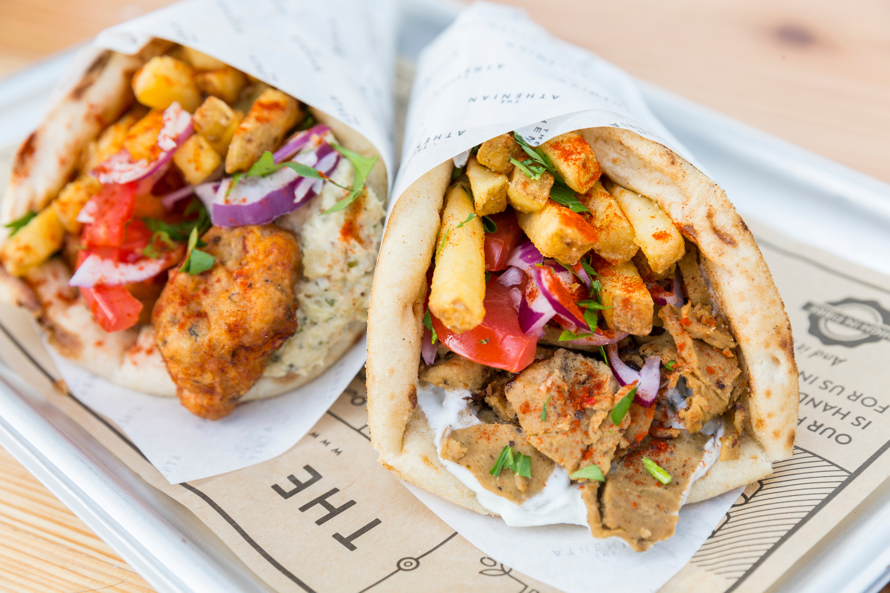

терминология:

сувлаки - собственно пита с *начинкой*

гирос - кебабное? мясо свинки с вертеля

клалмаки - милые минишашлычки кубиками ~2x2x2 см3

начиночька: мяско (гирос/каламаки/курица/шото), картошка фри, помидор, цибуля, клевый соус на основе йогурта

и стоит в среднем немного дороже кофе!11::: 2.7є

я бы предпочел это шавухам на самом деле, 

а еще вспомнил, купил в магазине лаваш из холодильника, попросил разогреть, ребята из греции охуели, сказали мы такого не делаем, а касирша взяла, оставила касу (на две минуты) пошла с нами, разогрела. ы. 

в ираклеоне нашел доритос и !arizona iced tea! прикольно. но думал доритос будут вкуснее.

## сицилия🥶

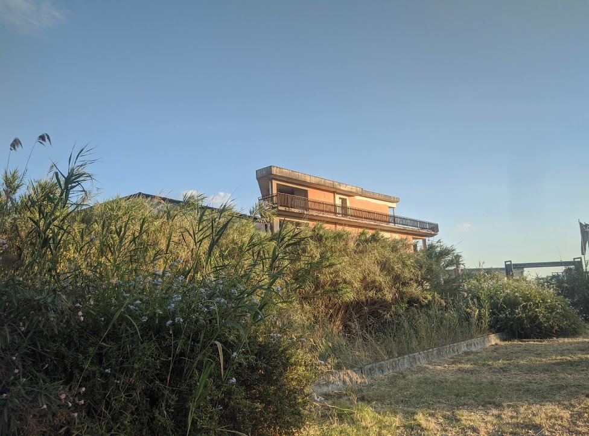

когда летели назад, пробыли 17 часов в катании (портовый город, 250к людей)

### *нелегалы*

сразу вышли на улицу быть нелегалами (нам по идее можно было находиться только на территории аэропорта). захотели пойти в центр покушать а там страшно идти. в районе возле аэропорта ничего нет, нет тротуаров, на обочинах улиц не дома а стены с колючей проволокой. милитарная зона короче.

### *поели симпсонов*

нашли потом пиццерию симпсоны в 13 минутах, скушали симпсонов [там пиццы называются именами персонажей]. выглядит немного убого но в центр идти страшно, еще депортируют.

### 🥶

ночью аэропорт закрылся, спали мы на улице. холодно очень. потом он открылся и внутри тоже было холодно очень. кондиционеры amiright

### *единственная клевая штука в аэропорту:*

помимо футуристических кранов с сушилками для рук сразу по бокам, там был

рояль

и я сыграл тему джоджо golden wind будучи в сицилии, очень доволен этим фактом.

# послевкусие

хорошее. 10 дней ощущаются очень *много* потому что было всего *много*. потратил всего 235є не считая билетов по 40є. думаю поснимать домик где то в греции на месяц неплохая идея на будущее.